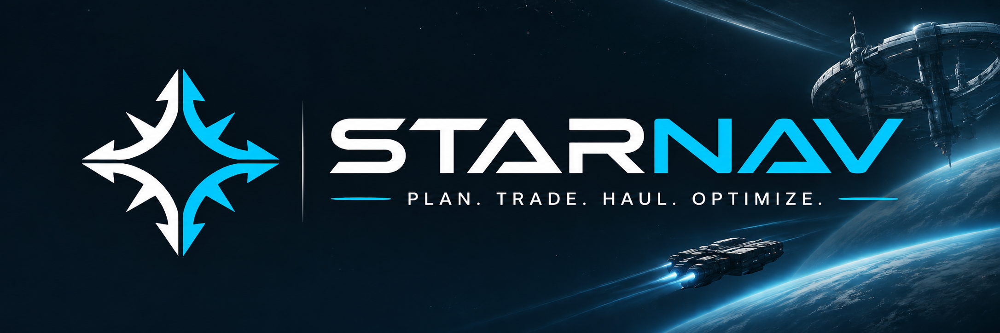

<p align="center">
  
</p>

<p align="center">
  <a href="LICENSE"></a>
  
  
  
</p>

**StarNav** est un outil web de freight pour [Star Citizen](https://robertsspaceindustries.com/), auto-hébergeable. Il répond à une question : *avec mon vaisseau, mon budget et ma position, qu'est-ce que j'achète, où, où je le revends, et dans quel ordre je charge ma soute ?*

> **Statut : développement précoce.** Il n'y a pas encore d'interface. Le dépôt contient aujourd'hui le socle (types partagés, import des données de vaisseaux) et le début du moteur de placement de cargo. Voir la [feuille de route](#feuille-de-route).

---

## Ce que StarNav vise à faire

| Module | Contenu | État |
|---|---|---|
| Données de vaisseaux | Import des grilles de soute depuis le wiki Star Citizen, validées par des tests | Fait (5 vaisseaux de départ) |
| Moteur cargo | Placement de conteneurs dans les grilles (toutes orientations, max de conteneur par grille) | En cours |
| Plan de chargement | Ordre de chargement en étapes, en tenant compte de l'accessibilité depuis l'entrée de la soute | Prévu |
| Visualiseur de prix et de trades | Prix, stocks, marges, fraîcheur des données | Prévu |
| Visualiseur 3D de soute | Grilles et conteneurs en 3D, rejeu du plan de chargement | Prévu |
| Planificateur de routes | Feuille de route à étapes cochables, classement des options par rentabilité nette par heure | Prévu |
| Alertes | Proposition d'une meilleure option quand elle apparaît, sans jamais changer la route seul | Prévu |
| Profits | Profit net (carburant, location, temps), bilan de route | Prévu |

## Principes

- **Le joueur décide.** L'outil propose, il n'impose jamais : aucun changement de route ou de cargaison sans validation explicite.
- **Feuille de route vivante.** Une route est un plan de session avec des étapes à cocher, recalculé quand les prix bougent.
- **Rentabilité nette.** Le classement se fait par profit net par heure, distance, carburant et coût du vaisseau compris.
- **Données honnêtes.** Chaque prix affiche son âge. Une donnée manquante est signalée, jamais inventée.

La spécification complète (planificateur, alertes, modèle de données, milestones détaillés) est dans [`docs/SPECIFICATION.md`](docs/SPECIFICATION.md).

## Démarrage rapide

Prérequis : [Node.js](https://nodejs.org/) (version LTS récente) et [pnpm](https://pnpm.io/).

```bash
git clone https://github.com/opsiexe/Starnav.git
cd Starnav
pnpm install
pnpm test            # lance les tests de tous les paquets (Vitest)
```

Pour régénérer les données de vaisseaux depuis l'API du wiki (accès réseau requis) :

```bash
pnpm fetch-ships     # écrit data/ships/<slug>.json
```

Aucune clé API ni variable d'environnement n'est nécessaire à ce stade. Une clé UEX sera requise plus tard pour la collecte des prix ; elle ne sera jamais versionnée.

## Structure du dépôt

```
.
├── packages/
│   ├── shared/          # types, conversion des données du wiki, validation
│   └── cargo-engine/    # orientations, occupation d'une grille, recherche de placement
├── data/ships/          # grilles de soute des vaisseaux (JSON versionnés)
├── scripts/             # import des données (fetch-ships)
└── docs/                # sources de données, spécification
```

Prévus : `apps/web` (React + Three.js), `apps/api` (Node.js, PostgreSQL), `packages/route-engine`.

## Feuille de route

| Milestone | Sujet | État |
|---|---|---|
| M0 | Validation des données (sources, accès, licences) | Terminé, quelques points mineurs ouverts |
| M1 | Socle du dépôt et données de vaisseaux | Terminé |
| M2 | Moteur cargo | En cours |
| M3 | Collecte et stockage des prix | Prévu |
| M4 | Visualiseurs de prix et de trades | Prévu |
| M5 | Visualiseur 3D de soute | Prévu |
| M6 | Distances, temps et coûts | Prévu |
| M7 | Générateur de routes | Prévu |
| M8 | Feuille de route interactive | Prévu |
| M9 | Alertes et recalcul | Prévu |
| M10 | Temps adaptatif et profits finaux | Prévu |
| M11 | Extension et déploiement | Prévu |

## Données et crédits

StarNav s'appuie sur des données communautaires. Merci à leurs auteurs.

| Source | Usage | Remarque |
|---|---|---|
| [API du wiki Star Citizen](https://api.star-citizen.wiki) | Géométrie des vaisseaux (grilles de soute, dimensions, quantum) | Les fichiers de `data/ships/` en sont dérivés. L'usage commercial n'est pas autorisé par cette source. |
| [UEX Corp](https://uexcorp.space) | Prix, terminaux, distances (prévu) | Les conditions de réutilisation sont à valider avant tout usage public d'un service en ligne. |

Le détail des champs utilisés, des tests réalisés et des données saisies à la main est dans [`docs/sources.md`](docs/sources.md).

## Contribuer

Les retours sont les bienvenus : ouvrez une [issue](https://github.com/opsiexe/Starnav/issues) pour signaler une donnée de vaisseau erronée, proposer une idée ou poser une question. StarNav est aussi un projet d'apprentissage : merci d'ouvrir une issue avant de proposer une pull request.

## Sécurité

Pour signaler une vulnérabilité, suivez la procédure de [`SECURITY.md`](SECURITY.md).

## Licence

Le code est publié sous licence [MIT](LICENSE). Les données de tiers (wiki Star Citizen, UEX) restent soumises à leurs propres conditions.

*StarNav est un projet de fan non officiel, non affilié à Cloud Imperium Games. Star Citizen®, Roberts Space Industries® et Cloud Imperium® sont des marques déposées de Cloud Imperium Rights LLC. Les noms de vaisseaux et de lieux appartiennent à leurs propriétaires respectifs.*
